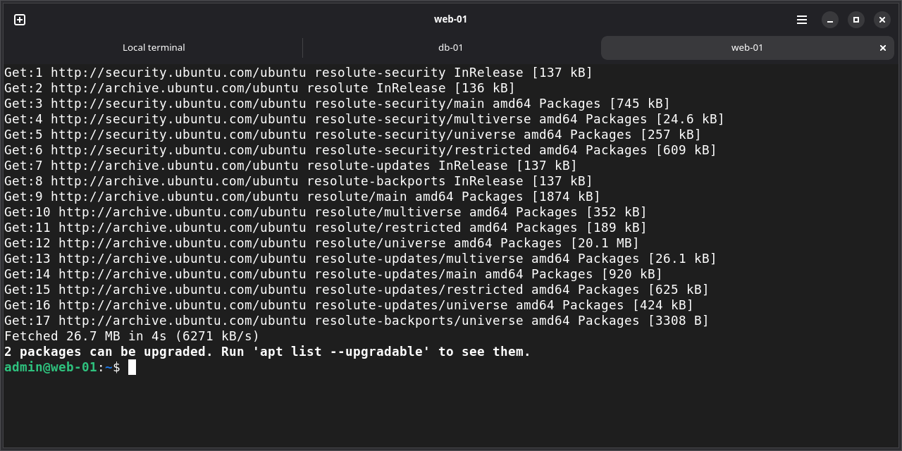
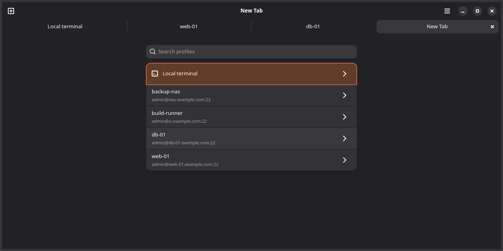
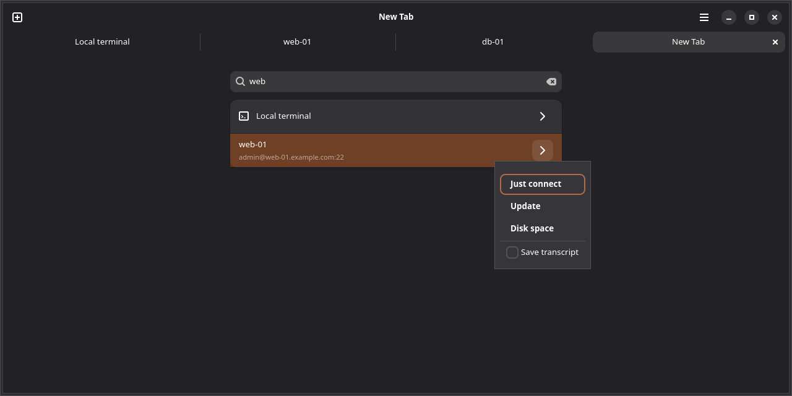
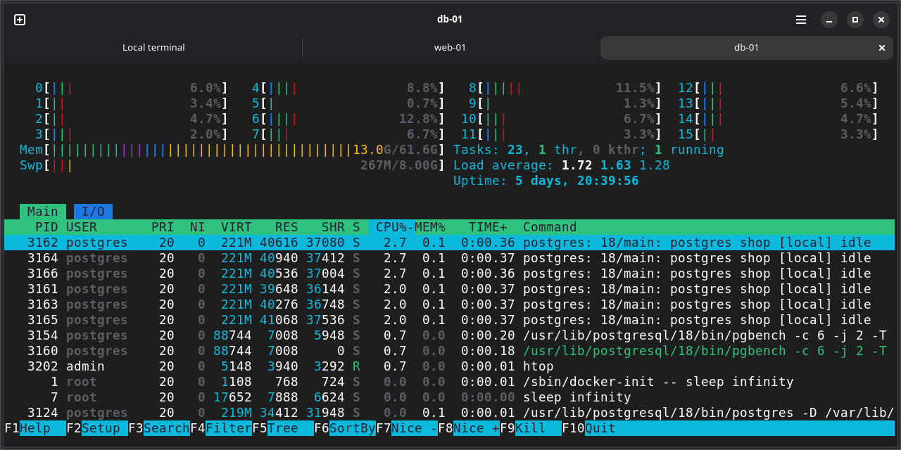

<h1 align="center">Moniker</h1>

<p align="center">
  <strong>A Linux terminal built around saved SSH connections.</strong><br>
  One click to a logged-in shell, startup commands that run by themselves, and credential sync between your own machines with no server in the middle.
</p>

<p align="center">
  <a href="LICENSE"></a>
  <a href="https://github.com/justinsloan/moniker/releases/latest"></a>
  <a href="https://github.com/justinsloan/moniker/actions/workflows/ci.yml"></a>
  
  
  
</p>

<p align="center">
  
</p>

---

## Why Moniker?

If you log in to the same machines many times a day, an ordinary terminal has you:

- **Typing the same login again and again.** Host, user name and password, every time.
- **Repeating the same commands after every login**, such as `apt update`.
- **Keeping hosts and passwords in step by hand** across a laptop and a desktop, or handing them to a vendor's cloud to sync them for you, usually behind a subscription.

Moniker is a terminal first. VTE, the engine behind GNOME Terminal and Console, renders htop, tmux and vim, and Moniker adds no per-frame work on top of it. Next to that, a saved **connection profile** is one click from a logged-in shell, and profiles sync between your own machines over plain SSH, encrypted with a key that only those machines hold.

> [!NOTE]
> Moniker is alpha software (0.6.1, alpha 6). Expect rough edges, and see the [known limitations](#known-limitations).

## Features

- 🔑 **One click to a logged-in shell.** A profile holds the host, user name, port, an optional key file and a password. Pick it in the new-tab list and the tab logs in with no typing. The password lives in the system keyring and reaches `ssh` through a helper that answers only that host's password prompt, never through a file, the command line or the environment.
- ▶️ **Startup sequences.** Give a profile as many named command lists as you like ("update", "tail the logs"). Connect with one and its commands run after login, then you are left in your normal interactive shell. Name one as the profile's default and every plain click on it runs that one. Local terminal can have sequences of its own, run in your shell on this computer.
- 🔄 **Sync with no server.** Profiles and passwords sync between your own machines over plain SSH. The bundle is encrypted with a shared sync key (Argon2id, XChaCha20-Poly1305) before it leaves the machine, and the key itself is never sent. Changes merge both ways: profiles added on either side are kept, the newest edit of a profile wins and deletions propagate. Once set up, Moniker syncs in the background at every launch. You can turn sync off on a machine, and keep any one profile on a single machine.
- 📝 **Transcripts.** Save a plain-text transcript of any session, remote or local: per profile, per connection, or of every session. The Transcripts window lists them by day, filters by host, searches across all of them, and exports or deletes them. A tab that is saving one shows a record icon and REC before its name. Transcripts never leave the machine.
- 🖥️ **A real terminal.** Tabs, panes side by side or one above the other in any arrangement (to compare two servers, say), several windows, tabs and panes dragged from one window to another, a text size per pane, copy and paste with bracketed paste, and saved layouts that open a whole window's tabs and panes in a new window in one pick, reconnecting each one. It can be your [default terminal](#the-command-line-and-moniker-as-the-default-terminal), for Files' "Open in Terminal" and apps that run in a terminal. Moniker keeps only a handful of [shortcuts](#keyboard-shortcuts); every other key, Ctrl+Tab and F10 included, goes to the program in the terminal.
- 🎨 **The modern GNOME look.** libadwaita, following the system light or dark style, terminal colors close to GNOME Console's, and a Connection Profiles window laid out like GNOME Settings.
- 🟢 **Which hosts answer.** A small mark before each profile's name, in the new-tab list and the Connection Profiles window, says whether its host answers a ping from this machine right now: a green dot if it does, a red ring if three pings got no reply or its name is not found, a gray dash until it is known. Hover it for the words. Turn it off in Preferences.
- 🗄️ **Headless machines too.** `moniker-server` is a command line with no GTK, for a server that only takes part in sync.
- 🚫 **No cloud, no account, no telemetry.** The only network traffic is your own `ssh` connections and, unless you turn them off in Preferences, the pings that show which saved hosts answer. They carry nothing from Moniker.

## Screenshots

<table>
  <tr>
    <th>New-tab list</th>
    <th>Connect choices</th>
  </tr>
  <tr>
    <td></td>
    <td></td>
  </tr>
  <tr>
    <th colspan="2">htop over SSH, started by a startup sequence</th>
  </tr>
  <tr>
    <td colspan="2" align="center"></td>
  </tr>
</table>

## Getting started

### Download

`.deb` and `.rpm` packages for x86-64 are on the [Releases page](https://github.com/justinsloan/moniker/releases/latest). They need **Ubuntu 26.04** or **Fedora 44** or newer, the first releases with libadwaita 1.9. Each release has two packages: `moniker`, the terminal app, and `moniker-server`, the command line and the password helper, which `moniker` depends on.

```sh
# Ubuntu
sudo apt install ./moniker_0.6.1_amd64.deb ./moniker-server_0.6.1_amd64.deb
# Fedora
sudo dnf install ./moniker-0.6.1-1.fc44.x86_64.rpm ./moniker-server-0.6.1-1.fc44.x86_64.rpm
```

A headless machine that only syncs needs just `moniker-server`. Passwords and the sync key are kept in the system keyring (a Secret Service such as GNOME Keyring), which must be running and unlocked.

To check a download against the release's `SHA256SUMS`, and, with GitHub CLI 2.49 or newer (Ubuntu 26.04's own `gh` package is 2.46), that GitHub Actions built it from this repository:

```sh
sha256sum --ignore-missing -c SHA256SUMS
gh attestation verify moniker_0.6.1_amd64.deb --repo justinsloan/moniker
```

### Run from source

Requires Rust 1.92 or newer (the core and `moniker-server` build with 1.89), a C compiler, pkg-config, and the development files of GTK 4.18+, VTE 0.76+ and libadwaita 1.9+.

```sh
sudo apt install build-essential pkg-config libadwaita-1-dev libvte-2.91-gtk4-dev   # Ubuntu
sudo dnf install gcc pkgconf-pkg-config libadwaita-devel vte291-gtk4-devel           # Fedora
git clone https://github.com/justinsloan/moniker.git
cd moniker
cargo build --workspace
target/debug/moniker
```

If a Moniker you installed is running, quit it before you start the one you built: both use the application id `org.moniker.Moniker`, so starting a second only asks the one already running to show a window.

Build with `--workspace`, not just `cargo run -p moniker-gui`: the password helper `moniker-askpass` must sit next to `moniker`. Without it Moniker cannot use stored passwords, and it says so. On a headless machine, `cargo build --release -p moniker-cli` builds only `moniker-server` and `moniker-askpass`, with no GTK.

## Using Moniker

Moniker opens with one local terminal: your login shell, in your home directory. The header bar has **＋** for a new tab and **☰** for everything else.

| Action | How |
|---|---|
| **New tab** | **＋** or <kbd>Ctrl</kbd>+<kbd>Shift</kbd>+<kbd>T</kbd> shows a searchable list: **Local terminal**, then every profile. What you pick turns that same tab into the session. Local terminal opens a shell, running its [default startup sequence](#startup-sequences-for-local-terminal) if you gave it one. |
| **Connect** | Click a profile, or press <kbd>Enter</kbd> on it. It logs in, runs the profile's [default startup sequence](#profiles-and-startup-sequences) if it has one, and leaves you in the normal shell. |
| **Connect with options** | **›** on a row (or <kbd>→</kbd>): **Just connect** (without the default sequence), each startup sequence by name, and a **Save transcript** box for this one connection. Local terminal has a **›** too: **Just open** and each of its own startup sequences, or just **Open** while it has none, and the same box. |
| **Add or edit profiles** | **☰ → Connection Profiles**. Double-click a profile there, or press its **Connect** button, to open a session in the main window you used last. |
| **Read transcripts** | **☰ → Transcripts**. |
| **Sync** | **☰ → Sync Now**, once sync is set up (see [Syncing two machines](#syncing-two-machines)). It is grayed out while sync is turned off. |
| **Split a tab** | <kbd>Ctrl</kbd>+<kbd>Shift</kbd>+<kbd>R</kbd> puts a new pane on the right, <kbd>Ctrl</kbd>+<kbd>Shift</kbd>+<kbd>D</kbd> one below (also **Split Right** and **Split Down** when you right-click a terminal). The new pane shows the same list as a new tab. See [Panes](#panes). |
| **Save a window's layout, or open one** | The **Layouts** button, right of **＋**: **Save Layout…** saves this window's tabs and panes under a name, and picking a saved layout opens it in a new window. See [Saved layouts](#saved-layouts). |
| **Rename a tab** | Double-click it, or right-click it, then **Rename…**. |
| **New window** | **☰ → New Window**, or drag a tab out of the tab bar. A tab can also be dragged into another Moniker window. |
| **Text size** | The row at the top of **☰** (− 100% +), or the keys below. |

### Keyboard shortcuts

| Keys | Action |
|---|---|
| <kbd>Ctrl</kbd>+<kbd>Shift</kbd>+<kbd>T</kbd> | New tab |
| <kbd>Ctrl</kbd>+<kbd>Shift</kbd>+<kbd>R</kbd> / <kbd>Ctrl</kbd>+<kbd>Shift</kbd>+<kbd>D</kbd> | Split right / split down |
| <kbd>Ctrl</kbd>+<kbd>Shift</kbd>+<kbd>W</kbd> | Close the pane (in a tab with one pane, the tab) |
| <kbd>Ctrl</kbd>+<kbd>Shift</kbd>+<kbd>←</kbd> <kbd>→</kbd> <kbd>↑</kbd> <kbd>↓</kbd> | Go to the pane that way (in a tab with several panes) |
| <kbd>Ctrl</kbd>+<kbd>Shift</kbd>+<kbd>N</kbd> | New window |
| <kbd>Ctrl</kbd>+<kbd>PgUp</kbd> / <kbd>Ctrl</kbd>+<kbd>PgDn</kbd> | Previous / next tab |
| <kbd>Ctrl</kbd>+<kbd>Shift</kbd>+<kbd>C</kbd> / <kbd>Ctrl</kbd>+<kbd>Shift</kbd>+<kbd>V</kbd> | Copy / paste |
| <kbd>Ctrl</kbd>+<kbd>+</kbd> / <kbd>Ctrl</kbd>+<kbd>−</kbd> / <kbd>Ctrl</kbd>+<kbd>0</kbd> | Larger / smaller / normal text, in this pane |
| <kbd>Ctrl</kbd>+<kbd>,</kbd> | Preferences |

Every other key, <kbd>Ctrl</kbd>+<kbd>C</kbd>, <kbd>Ctrl</kbd>+<kbd>Tab</kbd> and <kbd>F10</kbd> included, goes to the program in the terminal. Larger text also answers to <kbd>Ctrl</kbd>+<kbd>=</kbd>, and all three text size keys work on the keypad. Two trade-offs: <kbd>Ctrl</kbd>+<kbd>−</kbd> no longer reaches the program (readline's undo is still on <kbd>Ctrl</kbd>+<kbd>_</kbd>), and in a tab with several panes <kbd>Ctrl</kbd>+<kbd>Shift</kbd>+arrows move between panes instead of scrolling a line (up and down) or jumping to the previous or next prompt (left and right), which they still do in a tab with one pane. **☰ → Keyboard Shortcuts** shows the same list.

### Tabs and windows

- With one tab there is no tab bar. A remote tab is named after its profile, and the remote shell cannot change that; a local tab follows its shell's title until you rename it.
- Closing a tab or a window hangs up whatever runs in it: the `ssh`, or the shell and its job. Closing the last window quits.
- Each tab (each pane, in a split tab) has its own text size, from 50% to 300%. A new tab or pane starts at the size of the one you were in, and the size of the last window's active one is remembered for the next launch.
- While a dialog such as Rename, About or Preferences is open, the tab, copy, paste and text size keys leave the tab behind it alone, so <kbd>Ctrl</kbd>+<kbd>Shift</kbd>+<kbd>V</kbd> pastes into the dialog's field.
- **Copy and paste:** select with the mouse and press <kbd>Ctrl</kbd>+<kbd>Shift</kbd>+<kbd>C</kbd>; <kbd>Ctrl</kbd>+<kbd>Shift</kbd>+<kbd>V</kbd> pastes. Right-click a terminal for a menu with Copy and Paste (into that terminal) and Split Right and Split Down. When the program is using the mouse (htop, mc, tmux with mouse on), a plain right-click goes to the program and <kbd>Shift</kbd>+right-click opens the menu. A multi-line paste reaches a shell that supports bracketed paste as one block instead of running line by line. Middle-click still pastes the selection.

### Panes

A tab can hold several panes, each its own session: a connection or a local shell, with its own title, text size and transcript.

- **Splitting.** <kbd>Ctrl</kbd>+<kbd>Shift</kbd>+<kbd>R</kbd> (right) or <kbd>Ctrl</kbd>+<kbd>Shift</kbd>+<kbd>D</kbd> (down) halves the pane you are in; the new pane shows the new-tab list. Split again, either way, for any arrangement: three side by side, or two side by side with one of them split top and bottom. Drag a divider to resize.
- **The pane you are in** has a marked header; the others' titles are dimmed. The tab and the window are titled after it, and the text size keys, copy and paste act on it. Click a pane, or press <kbd>Ctrl</kbd>+<kbd>Shift</kbd>+an arrow, to go to another. The tab's tooltip lists every pane.
- **Moving panes.** Drag a pane by its header: onto another pane (in any tab or window) to put it beside that one, on the side you drop it nearest to; onto a tab in the tab bar to make it a tab of its own (the tab bar shows while you drag, and hovering over a tab opens it, so you can drop into its panes); or outside every window for a window of its own. The header's menu has **Move to New Tab** and **Move to New Window** too.
- **Tiling tabs.** Drag a tab from the tab bar onto a pane, or onto the terminal of a tab with one pane: its panes go beside it, laid out as they were, and the tab goes. Dropped on a tab bar, a tab moves as a tab.
- **Closing.** The × in a pane's header or <kbd>Ctrl</kbd>+<kbd>Shift</kbd>+<kbd>W</kbd> closes that pane and hangs up its session, and the pane beside it takes the room. A session that ends closes its pane as it would close its tab. The tab's own × closes all of its panes.

### Saved layouts

A **layout** is the arrangement of a whole window, saved under a name: every tab, how its panes are split and how far, and for each pane what it was, the name you gave it and its text size. Opening one starts a new window with that arrangement and reconnects it. It is only a layout: nothing keeps running after a window closes (closing still hangs up what runs in it), and no scrollback or program is saved.

The **Layouts** button right of **＋** (the word, an icon of two windows and a down arrow) lists the saved layouts by name. Press **Save Layout…** at the bottom of the list to save the window you are in, as it is when you answer. It asks for a name ("Layout 1" to start with; a name of nothing, one with a control character or one over 100 characters is refused, with the reason), and asks "Replace “name”?" for a name already in use. Pick a layout in the list to **open it in a new window**: a window with just that layout's tabs, the first of them selected, in front, with the keyboard in the pane that had it when you saved. The window you picked it in is left as it was, with the keyboard back in its terminal, and the layout stays saved. Picking it twice opens two windows. A layout that has gone since the menu opened (another window deleted or renamed it), or a file that cannot be read, opens nothing, and the window you picked it in says why. A name too long for the list is cut short there, and its tooltip has all of it. If you don't use layouts, turn off **Show the Layouts menu** in Preferences: the button goes from every window, and the layouts you saved are kept for when you turn it on again.

The **›** on a layout has **Update…**, **Rename…** and **Delete…**:

- **Update…** asks `Update “name”?` and, on **Update**, replaces that layout with the window you are in, as it is when you answer (a tab you opened while the question was up is in it), keeping its name and its place in the list. Cancel (the default) and <kbd>Escape</kbd> change nothing. A window does not remember which layout it was opened from, so any window can update any layout: you choose it in the menu. A layout is known by its name, so Update replaces whatever layout has that name when you answer. One that another window deleted or renamed while the question was open is not saved again: nothing is written and the message says "That layout is no longer saved.". A file that cannot be read is left as it is and the message says so, with no question to replace it, as there is no layout in it to update.
- **Rename…** asks for the new name, with the same reasons for refusing one, and refuses another layout's name.
- **Delete…** asks first, and leaves windows that are open as they are.

What each pane comes back as:

| It was | It comes back as |
|---|---|
| A connection to a saved profile | The same profile, connected by itself as a click would, with no typing: it runs the profile's [default sequence](#profiles-and-startup-sequences) if it has one, and saves a transcript as a click would: if the profile's **Save transcript** switch or **Save transcripts of all sessions** is on when you open the layout, whatever the pane did when it was saved (a new transcript, never the old one's text). A pane whose connection had ended is still that profile. If the profile has been deleted since, the new-tab list with a note, "name is no longer saved.". A profile renamed since still connects (the layout knows it by its id). |
| A local terminal | A shell in the folder its shell last reported, or your home folder if that folder is gone or cannot be entered, or none was reported. The folder comes from the shell, which tells the terminal where it is: bash and zsh do on Ubuntu (through `vte-2.91.sh`); a shell that does not, plain `sh` for one, comes back in your home folder. Only a folder reported for this computer counts: one a shell reports for another machine (say you ran `ssh` by hand in the pane) is not saved. It runs [Local terminal's default startup sequence](#startup-sequences-for-local-terminal) if it has one, in that folder, as a pick of Local terminal does. It saves a transcript if Local terminal's **Save transcript** switch or **Save transcripts of all sessions** is on, as a new local tab does. A pane started with `moniker -- COMMAND` comes back as a shell in its folder, under the name `-T` or `--title` gave it if any: the command is never saved. |
| The new-tab list | The new-tab list. |

A pane you renamed keeps its name, a pane keeps its text size, and the splits keep their arrangement (side by side, one above the other, in any depth) and how far along each divider was, a little less exactly for a split inside another. A tab that was not selected when you opened the layout takes its divider positions when you first look at it.

- **The new window.** An ordinary Moniker window with its own Layouts menu, holding the layout's tabs and nothing else (no local tab of its own). It opens at the size **New Window** uses (the size the last window had when it closed, maximized if that one was) and is saved when it closes like any other.
- **Never at launch.** Moniker still opens with one local tab, and **☰ → New Window** opens one too, so that it works as the default terminal. A layout is opened only from the Layouts menu.
- **The keyring.** Restored connections ask the system keyring one after another, tab after tab and pane after pane in reading order, as any connection does. With the keyring locked they wait ("Waiting for the keyring…"), and the rest of the window keeps working.
- **No secrets.** A layout holds each profile's id (and its name, only to say which profile is gone), never a password, a host, a user name, a key file, a startup sequence, a command line or anything the terminal showed. A restored connection runs only the sequence you chose as the profile's default, or none, and so does a restored local pane with Local terminal's.
- **Where.** `~/.config/moniker/sessions.json` (mode 0600), on this machine only: layouts are never synced. The file is still called that, because it is what it was called when layouts were called sessions: Moniker 0.6.0 and 0.6.1 read and write the same file and show the same layouts, which they call sessions. An entry in it that Moniker cannot read (a hand edit, a newer Moniker's) is skipped, and kept with its contents when you save another layout (its keys may come back in another order). A file it cannot read at all (not JSON, or another version) is said in the menu, and saving then asks "Replace the Saved Layouts File?" with the reason, so that a file you may want to repair is never overwritten without asking.
- **Limits.** A window with more than 64 tabs, a tab with more than 32 panes or splits nested more than 16 deep cannot be saved: the save or update says why and writes nothing. A `sessions.json` over 4 MiB is not read: the menu says it is larger than 4 MiB, and saving asks "Replace the Saved Layouts File?" as for a damaged file. Nothing is written that would make the file larger than 4 MiB.

### Profiles and startup sequences

- **Editing saves field by field.** A changed text field shows a ✓, and the value is saved only when you press ✓ or <kbd>Enter</kbd>; leave the field without that and the edit is dropped. Switches, the port and the key file save when changed. A mistake, such as an empty host, marks the field and a notification says why, and nothing is saved. Saving never holds up the window: if the profile file is busy (a sync is writing it), the field keeps what you set, shows a small spinner after a moment, and is saved once the file is free.
- **Passwords:** the password field is empty unless you type a new one, and leaving it empty keeps the stored password. **Remove stored password** deletes it from this machine only.
- **Sync to other machines** is a switch on the profile page, on for every profile to start with. Turn it off to keep the profile on this machine only; see [Keeping a profile on this machine only](#keeping-a-profile-on-this-machine-only). A profile kept here has a small computer icon at the end of its row, in the Connection Profiles window and in the new-tab list.
- **Startup sequences** are listed on the profile page, one row each. Open one to name it and type its commands, one per line, then Save or Cancel; Move Up and Move Down set the order of the Connect choices. A profile with no sequences gives a plain shell.
- **Default sequence.** A profile with at least one sequence has a **Default sequence** row under them: **None**, or one of its sequences, saved when you pick. The default runs every time the profile connects with a plain click: in the new-tab list (a click or <kbd>Enter</kbd>), a double-click, <kbd>Enter</kbd> or **Connect** in the Connection Profiles window, and a pane that a [saved layout](#saved-layouts) brings back. The **›** choices still offer **Just connect**, which skips it, and each sequence by name, which runs that one (not the default as well). The default follows its sequence when you move it up or down, and deleting that sequence clears it. It is part of the profile, so it syncs with it.
- Narrow the Connection Profiles window and it shows one pane at a time, with a back button.

### Startup sequences for Local terminal

Local terminal can open with commands already run, as a connection does. It has its own startup sequences, edited on the **Local terminal** entry at the top of the sidebar in **☰ → Connection Profiles**. That entry is always there, above the profiles: it is not a profile, and there is nothing to delete. Its page has two groups. **Startup sequences** has a row for each sequence, **Add sequence**, and, once there is a sequence, a **Default sequence** row (**None** or one of them, saved when you pick); a sequence opens on the page a profile's sequence opens on (its name, its commands one per line, Save, Cancel, Move Up, Move Down, Delete Sequence). **Session** has Local terminal's own **Save transcript** switch. There is nothing else: no host, user name, password or Delete button. The header button reads **Open** instead of Connect, and a double-click or <kbd>Enter</kbd> on the entry opens too.

- **How a sequence runs.** Your shell on this computer (`$SHELL`, else `/bin/sh`) runs the commands with `-c` and ends with `exec "$SHELL"`, so when they are done you are left in a new interactive shell of the same kind, as after a connection's sequence. It is the shell a plain local tab runs, so the commands are written in your shell's language. The last line Moniker adds is `exec "$SHELL"`, so a shell that does not understand that line (nushell, elvish) ends the sequence's tab with a note instead of leaving you in a shell, and with `-c` bash, zsh and sh read none of their interactive startup files, so the aliases and functions of your `~/.bashrc` or `~/.zshrc` are not there while the sequence runs (they are in the shell it leaves you in). The tab starts in your home folder (a pane that a saved layout brings back, in its folder) and is named like any local tab, after the shell's title until you rename it. A saved layout saves it as a local pane, in the folder its shell last reported or else the one it started in, and never its commands.
- **When the default runs.** On every plain pick of Local terminal: a click or <kbd>Enter</kbd> on it in the new-tab list (a new tab, or a new pane after a split), **Open**, a double-click or <kbd>Enter</kbd> in the Connection Profiles window, and each local pane that a [saved layout](#saved-layouts) brings back, in its folder. The **›** choices on Local terminal are **Just open**, which skips the default, then each sequence by name, which runs that one only (not the default as well), and the **Save transcript** box; with no sequence they are **Open** and the box. The default follows its sequence when you move it up or down, and deleting that sequence clears it.
- **When nothing runs.** Never in the tab Moniker opens a window with: the one at launch, the one **☰ → New Window** opens, and every [command-line launch](#the-command-line-and-moniker-as-the-default-terminal), Files' **Open in Terminal** and `moniker -- COMMAND` among them. Those are where Moniker is the terminal of other programs, and a sequence there would run at every launch and could move the shell away from the folder it was asked for. A pane that a layout brings back is not that tab, and runs the default.
- **How it ends.** Like a connection, not like a plain shell: when the shell you are left in exits with status 0 the tab closes, and any other end keeps it with a note, `[session ended: status N]` or `[session ended: signal N]`, so what the sequence printed stays on the screen. Two things you will meet. <kbd>Ctrl</kbd>+<kbd>C</kbd> during a command of the sequence ends the shell that runs it, and the tab stays with the note. And in the shell you are left in, a plain `exit` or <kbd>Ctrl</kbd>+<kbd>D</kbd> right after a command that failed also keeps the tab, with `[session ended: status 1]` or whatever that command's status was, because a shell exits with the status of the last command it ran. A plain local tab with no sequence closes whenever its shell exits.
- **Transcripts.** Local terminal's **Save transcript** switch (off to start with) is to local tabs what a profile's is to its connections: with it or **Save transcripts of all sessions** on, every local tab saves a transcript, the first tab of a window and a command-line launch's included. The **›** box still overrides it for one session. A tab that saves one shows REC, as any does.
- **Never synced, and kept apart from the profiles.** The sequences, the default and the switch are in a file of their own, `~/.config/moniker/local-terminal.json` (mode 0600), never in `profiles.json`, never in a sync, and unknown to `moniker-server`. A synced sequence would let any machine that holds your sync key choose commands that run here, so each machine has its own. They are stored as plain text: keep passwords out of them. A sequence name is shown as plain text. Moniker 0.6.0 and older know nothing of the file and never touch it, so starting an older Moniker on this machine (the one installed, or Files' **Open in Terminal** starting it) leaves your sequences as they are.
- **If the file cannot be read** (it is damaged, is not JSON, or is of another version, such as a newer Moniker's), Local terminal opens a plain shell as if it had no sequences and its own switch were off, the page shows no sequences, and every change is refused with "Could not save the local terminal: …" and the reason: the file is left as it is, never overwritten. A sequence in it that Moniker cannot read (only editing the file by hand makes one, such as a name with a control character) is skipped, and dropped the next time Moniker writes the file.

### Transcripts

A transcript is the plain text of a session, written when its tab ends or closes, to `~/.local/share/moniker/transcripts/<host>_<date>-<time>.txt` (UTC, mode 0600) unless Preferences chose another folder. A local terminal's transcript is named after this computer. Whether a session is saved is decided before its tab opens:

| Setting | Where | Effect |
|---|---|---|
| **Save transcript** switch | A profile's page | Every connection to that profile is saved. |
| **Save transcript** switch | The Local terminal page of the Connection Profiles window | Every local tab is saved: ones you open from the list, the first tab of a window (launch, **New Window**, a command-line launch) and a pane a saved layout brings back. |
| **Save transcript** box | The **›** choices of a profile or of Local terminal | Overrides the setting for this one session, in either direction. |
| **Save transcripts of all sessions** | Preferences (off to start with) | Every new tab is saved, the first one at launch included, whatever the profile says. The box under **›** then starts checked. |
| A [saved layout](#saved-layouts) opened | The **Layouts** menu | Each pane is saved as a click would save it, by the settings above as they are when you open the layout: a profile's pane if its **Save transcript** switch or **Save transcripts of all sessions** is on, a local pane if Local terminal's **Save transcript** switch or **Save transcripts of all sessions** is. What a pane did when the layout was saved does not count, so turning a switch off stops restored panes too. |

A tab that is saving a transcript says so, so you always see which sessions are being saved: a record icon and **REC** before its name, on the tab in the tab bar, in the window's title for the tab in front (where you see it with one tab, as the tab bar is hidden then), and on the pane's header in a split; the tab's tooltip ends with "Saving a transcript". It shows from the moment the session starts (a connection still waiting for the keyring shows nothing yet) and goes when the session ends and its transcript is written: a connection that failed keeps its tab and its note, without REC, while a session whose program could not be started at all ("[could not start …]") keeps REC until its tab closes, when its transcript is written. REC is not part of the name: renaming the tab keeps it, and a saved layout records the name alone.

The **Transcripts window** lists them under day headings (Today, Yesterday, then dates) with the host and the local start time. Sort Newest first or Oldest first, narrow the list to one host, or type in the search entry to keep only the transcripts that contain the text, each with its match count. Choosing one shows its whole text, read-only, with a search bar of its own that highlights every match: <kbd>Enter</kbd> or <kbd>↓</kbd> for the next, <kbd>↑</kbd> for the previous, <kbd>Ctrl</kbd>+<kbd>F</kbd> to focus it. **Export…** saves a copy (mode 0600, like the original) and **Delete** asks, then removes the file. The list follows the folder live, so a session that ends while the window is open appears in it.

Only files named the way Moniker names transcripts are listed; anything else in the folder is never read, searched or offered for deletion, so a folder you also use for other things is safe to choose. A line longer than 2,000 characters is shown broken into lines of 2,000, so that a transcript of one enormous line opens quickly. The file keeps the original text, search finds a match across a break, and copying a selection gives the original text, without the added breaks.

> [!WARNING]
> Transcripts record whatever appears in the terminal, and startup sequences are stored as plain text. Both can hold secrets you type or paste. Keep passwords out of them. Transcripts are never synced.

### Preferences

**☰ → Preferences** or <kbd>Ctrl</kbd>+<kbd>,</kbd>. Each change is saved at once and stays local to this machine.

| Group | Setting | Notes |
|---|---|---|
| Terminal | **Font** | Monospace fonts only. Applies to every open terminal at once. The reset button beside it (**Use the System Font**) goes back to the system monospace font. |
| Terminal | **Scrollback** | 1,000 to 1,000,000 lines (10,000 to start with), for tabs opened after the change. A tab that saves a transcript keeps all of its scrollback. |
| Layouts | **Show the Layouts menu** | On to start with. Turned off, the **Layouts** button goes from every window at once; the [saved layouts](#saved-layouts) are kept. |
| Connection Profiles | **Show whether hosts are reachable** | On to start with. Pings each saved host from this machine now and then (when a list shows it, then every minute while one is open) and marks it in the lists. Turned off, no pings are sent, no marks are shown and what was learned is forgotten: turned on again, every host is looked up afresh. |
| Transcripts | **Save transcripts of all sessions** | See [Transcripts](#transcripts). |
| Transcripts | **Transcripts folder** | **Choose…** picks another folder and moves the transcripts into it (below). |
| Sync | **Sync settings** | **Open** shows the Sync page of the Connection Profiles window. |

**Changing the transcripts folder** moves the old folder's transcripts into the new one, in the background. Files are renamed into place, or copied and then removed when the folders are on different file systems. A name already taken gets a number (`-2`, `-3`) and nothing is ever overwritten. Only files named like Moniker's transcripts move: any other file stays where it is and the message counts it, so choosing your home folder once cannot take your documents with it. A session saving a transcript meanwhile saves it into the new folder. When it is done, a message says how many were moved and, if anything stayed behind, names the old folder.

### Messages

What needs your attention (a transcript that could not be saved, `moniker-askpass` missing, the result of a sync, an export or a failed delete) appears as a notification at the top center of the window, just below the header bar. Notifications wrap onto several lines, fade after about 8 seconds (a little longer for a long one) and come one after another. They cannot be dismissed, so for that time one covers whatever is under it. While a dialog is open the window's notifications wait until it closes; Preferences shows its own at the bottom of the dialog. A message with no window left to show it goes to the standard error of the `moniker` process.

### The command line, and Moniker as the default terminal

```text
moniker [-w DIR | --working-directory=DIR] [-T TITLE | --title=TITLE] [--hold]
        [-- COMMAND [ARG]... | -e COMMAND [ARG]...]
moniker --help | --version
```

| Option | Effect |
|---|---|
| `-w DIR`, `--working-directory=DIR` | The terminal starts in DIR (a relative one is taken from where you ran `moniker`). With no folder, it starts where you ran `moniker`, or in your home folder if that is `/`, which is where many launchers start everything. |
| `-- COMMAND [ARG]...`, `-e COMMAND [ARG]...` | Run COMMAND with its arguments instead of your shell. Everything after `--` or `-e` belongs to the command, and nothing goes through a shell. When the command ends with status 0 the tab closes (and the window with it, if it was the last tab); any other end keeps the tab with a note such as `[session ended: status 1]`. A program that cannot be started shows `[could not start …]`. |
| `-T TITLE`, `--title=TITLE` | The tab's name, fixed as if you had renamed it: the program cannot change it. Without it a command's tab is named after the program until the program sets a title. |
| `--hold` | A command's tab stays open when the command ends, whatever its status, with a note such as `[session ended: status 0]`. |
| `--help`, `--version` | Print the usage or the version and exit. |

Every launch opens **a new window** with one local tab, and does it in the Moniker that is already running if there is one. A mistake (an unknown option, a missing value, `-e` with no command) prints one line, `moniker: …`, to the terminal you typed it in, exits with status 2 and opens nothing. A folder that is not a folder starts the terminal in your home folder and the window says so in a notification. The window is for a local terminal only: the command line never opens a connection profile. While Moniker runs, a launch does not pass its environment on: the new terminal, and a command in it, get Moniker's own. The launch that starts Moniker gives Moniker its environment, as any program gets its launcher's, and the terminals of that run inherit it. These tabs save a transcript when **Save transcripts of all sessions** or Local terminal's own **Save transcript** switch is on, like any other local tab; they never run one of [Local terminal's startup sequences](#startup-sequences-for-local-terminal).

**Making Moniker the default terminal.** Desktops start the default terminal with `xdg-terminal-exec`, which uses the first terminal in `~/.config/xdg-terminals.list`, then the system's list (Ptyxis on Ubuntu). Moniker's desktop file tells it how to pass a folder, a program, a title and `--hold`, so once Moniker is first in your list, Files' **Open in Terminal** opens a Moniker window in that folder and apps marked to run in a terminal (a `Terminal=true` launcher such as htop's) run in Moniker:

```sh
# You have no ~/.config/xdg-terminals.list yet: make one. (The set -C makes this refuse to overwrite a list that exists.)
(set -C; echo org.moniker.Moniker.desktop > ~/.config/xdg-terminals.list)
# You already have one (it is not empty): put the line first, and keep the rest. (GNU sed; check with `cat` afterwards.)
sed -i '1i org.moniker.Moniker.desktop' ~/.config/xdg-terminals.list
# Either way, this should print moniker, --working-directory=/tmp, -- and true, one to a line:
xdg-terminal-exec --print-cmd --dir=/tmp -- true
```

Use the first command only if `ls ~/.config/*xdg-terminals.list` finds no list, and the second for a list that has something in it (`sed` does nothing to an empty file: delete it and use the first command). To go back, delete the line (or the file, if you made it for this): the system's choice returns. If a list named for your desktop exists in `~/.config` (`ubuntu-xdg-terminals.list`, `gnome-xdg-terminals.list`), it comes before the generic one, so it needs the line as well: use the second command on it. Quit every running Moniker (close all its windows) before you try any of this, and again after you install or build a newer one. A Moniker that is still running from before has no command line handler, so launches (Files' **Open in Terminal**, `moniker -w …`) fail with nothing opened until it quits. A package and a build from source share the application id `org.moniker.Moniker`, so a launch always goes to whichever of them is already running.

**On Debian and Ubuntu**, the `moniker` package also registers `/usr/bin/moniker` as an `x-terminal-emulator` alternative (and provides the virtual package of that name, as Debian Policy asks of a terminal emulator), for programs that start "the terminal" the older way (`-e COMMAND ARG...` and `-T TITLE`, both understood). Its priority is 20, so it never outranks a terminal registered at 40 or above (Ubuntu's Ptyxis is at 40, so on Ubuntu installing Moniker does not change which terminal the system picks); `update-alternatives --display x-terminal-emulator` lists the choices and `sudo update-alternatives --config x-terminal-emulator` picks Moniker. Removing the package takes the alternative away (and only removing it does: an upgrade keeps it). The `.rpm` has none: Fedora's tools use `xdg-terminal-exec` alone.

Limits:

- Every launch is a new window; there is no way to open a tab in a window that already exists.
- A caller of `x-terminal-emulator -e COMMAND` that waits for the command to finish does not get that. While Moniker is running, a launch returns once the window is open, as with GNOME Terminal; the launch that starts Moniker stays until Moniker quits, whatever the command does.
- `moniker` started with `/` as its directory opens in the home folder, because launchers do that to everything.
- A name that is not valid UTF-8 is handled by where it comes from. A `-w` folder (or any other argument) like that is a mistake: one line, status 2, nothing opens. The folder `moniker` was started in is whatever it is: if its name is not valid UTF-8 it cannot be handed to a running Moniker, so the terminal starts in your home folder, and a notification says "Could not open …: its name is not valid UTF-8. The terminal started in your home folder."
- `-e "cmd args"` given as one argument runs a program named `cmd args`, which does not exist, and the tab shows `[could not start …]`. Pass the command and its arguments as separate words, `-e cmd args`: a command is a list of arguments and never a shell string, so quoting does not make it one.
- A list for your desktop in `~/.config` comes before the generic `xdg-terminals.list`, as above.
- A Moniker built from source needs `data/org.moniker.Moniker.desktop` in `~/.local/share/applications/` and `moniker` on the PATH before `xdg-terminal-exec` can use it.

### Where Moniker keeps things

| What | Where | Synced |
|---|---|---|
| Passwords and the sync key | The system keyring (Secret Service) | Passwords yes, the sync key never |
| Profiles, no secrets, and the sync switch | `~/.config/moniker/profiles.json` (mode 0600; format version 2 while sync is off or a profile is kept on this machine, version 1 otherwise) | Profiles yes, except those kept on this machine; the switch never |
| Sync partner, automatic sync, text size and window sizes for the next launch, Preferences | `~/.config/moniker/gui-settings.json` (mode 0600) | No |
| [Local terminal's startup sequences](#startup-sequences-for-local-terminal), its default and its transcript switch | `~/.config/moniker/local-terminal.json` (mode 0600) | No |
| When this machine last completed a sync | `~/.config/moniker/sync-state.json` (mode 0600) | No |
| [Saved layouts](#saved-layouts) (no secrets) | `~/.config/moniker/sessions.json` (mode 0600) | No |
| Transcripts | `~/.local/share/moniker/transcripts/`, or the folder chosen in Preferences | No |

If `gui-settings.json` is damaged, Moniker uses the defaults and leaves the file as it is; a Preferences change then says it cannot be saved. Two things on the Sync page do write a new file in its place: a sync started with its **Sync** button that succeeds, and turning **Sync Automatically** on or off.

`local-terminal.json` holds Local terminal's startup commands, as plain text: keep passwords out of them. Moniker 0.6.0 and older never read or write it. If Moniker cannot read it (damaged, or of another version), Local terminal runs no sequence and the file is left as it is: every change to Local terminal is refused, and nothing ever writes over it. A sequence in it that Moniker cannot read (only editing the file by hand makes one) is dropped the next time Moniker writes the file.

`profiles.json` is format version 1 until you use one of the two settings that stay on this machine. While sync is turned off, or any profile is kept on this machine only, Moniker writes it as version 2, and it goes back to version 1 when neither is true. Moniker 0.5.0 and older refuse a file of another version and leave it alone, so an older `moniker` or `moniker-server` on this machine can neither send a profile you keep here nor take part in a sync while sync is off. One that is already running cannot reload or save the file either. The cost: until you turn sync on and stop keeping profiles here, an older version on this machine says "unsupported profile store version 2" and shows no profiles. Moniker reads both versions.

## Syncing two machines

1. **Install Moniker on both.** The other machine needs only `moniker-server`: install its package, or run `cargo build --release -p moniker-cli` and then `sudo install -m 755 target/release/moniker-server target/release/moniker-askpass /usr/local/bin/`.
2. **Set the same sync key on every machine**, at least 12 characters, with `moniker-server sync-key set` (it asks twice and does not echo; `--stdin` reads it from a pipe) or on the Sync page of the Connection Profiles window. It is stored in the keyring and never sent.
3. **Make sure the other machine has an unlocked Secret Service** that a non-interactive ssh session can reach: received passwords are stored there. Without one the sync fails with a message and changes nothing.
4. **Save a profile for the other machine and connect to it once from a tab** to accept its host key. Sync never asks about host keys; it refuses unknown ones.
5. **Sync** from the Sync page of the Connection Profiles window, after choosing the other machine's profile there, or with `moniker-server sync <profile name>` (the name must be unique).
6. **From then on it is automatic.** Once a sync from the Sync page has succeeded, that profile is your sync partner: Moniker syncs with it at each launch, in the background (the terminal never waits, and a success is silent), and **☰ → Sync Now** syncs on request. A failure is one notification. The Sync page's **Sync Automatically** switch turns the launch sync off.

**Deleting a profile** deletes it on every machine you sync. Moniker remembers a deletion for a year, then forgets it, so that deletions do not pile up forever. A machine that has not synced for longer than that could still hold the deleted profile and bring it back. So when this machine or the other one has not completed a sync for more than 180 days, a sync asks first: Sync Now and the Sync page show **Sync Anyway?**, the sync at launch does not run and says so, and `moniker-server sync` stops unless you add `--allow-stale`. If a deleted profile does come back, delete it again.

> [!IMPORTANT]
> `moniker-server` must be on the other machine's *non-interactive* `PATH`, and `~/.cargo/bin` usually is not. Install it in `/usr/local/bin` or `~/.local/bin` (the packages put it in `/usr/bin`), then check that `ssh other-machine which moniker-server` prints a path.

### Turning sync off

The **Sync** switch at the top of the Sync page turns sync off on this machine. `moniker-server sync-switch off` does the same from a terminal, and `moniker-server sync-switch status` says whether sync is on or off (and why, if the setting could not be read). While sync is off, nothing leaves this machine and nothing is accepted from another:

- Moniker does not sync at launch, and shows no notification about it.
- **☰ → Sync Now** stays in the menu, grayed out. **Sync Automatically** and the Sync button on the Sync page are grayed out, with the line "Sync is turned off on this machine."
- `moniker-server sync <profile>` stops with "sync is turned off on this machine".
- **This machine also refuses a sync that another machine starts.** The machine that started the sync is told "Sync is turned off on the other machine.", the other machine being this one. Without that, any machine with your sync key and an ssh login here could still pull your profiles. The refusal comes before this machine reads the sync key from the keyring, so it causes no keyring prompt here.

The check is made by the code that does the syncing, in both roles, so a grayed-out button is a convenience and not the protection. The sync key and the sync partner are kept, so turning sync on again just works. A sync that is already running finishes; the next one is refused. If the setting is in the file but cannot be read, sync counts as off.

**Turning sync on asks first.** "Turn Sync On?" says that at the next sync every profile on this machine that syncs, including any added while sync was off, will be copied to your other machines with its stored password, and that to keep a profile on this machine only you cancel and turn off "Sync to other machines" on its page first. `moniker-server sync-switch on` says the same and asks `Turn sync on? [y/N]` when its input is a terminal; otherwise it changes nothing unless you add `--yes`. Turning sync off asks nothing, since it only stops data leaving. Profiles you add while sync is off sync like any other once it is turned back on.

### Keeping a profile on this machine only

Turn off **Sync to other machines** on a profile's page and Moniker asks "Keep “name” on This Machine Only?": the profile will be deleted from your other machines, with its stored password, the next time they sync, and it stays here. Cancel (or Escape) leaves everything as it was.

- **Nothing about a kept profile leaves this machine** except its id and a version time, in the shape of a deletion. Its name, host, user name, port, key file, sequences and password are not sent: its password is never put in a bundle. If the kept profile is the one a sync connects through, its stored password still logs in to that machine, as it does for any connection.
- **Nothing that arrives changes it.** A newer copy or a deletion from another machine leaves the kept profile and its stored password as they are.
- **Turning the switch back on asks too** ("Sync “name” to Your Other Machines?"): the profile is copied to your other machines, with its stored password, at the next sync, and the deletions sent while it was kept here cannot delete it again.
- **New Profile** has the same switch. Turned off there, the profile is created kept on this machine, and nothing asks, since no other machine has it yet.
- **The mark:** a profile kept here shows a small dimmed computer icon at the end of its row, in the Connection Profiles window and in the new-tab list, with the tooltip "On this machine only". Profiles that sync have no mark. The marks show each profile's own setting, whether sync is on or off. `moniker-server profile list` adds "(this machine only)".

To other machines running Moniker 0.5.0 or older, a kept profile looks like any deleted profile, which they already understand.

## How it keeps your passwords safe

Connecting with a stored password passes through these layers:

```text
 you pick a profile
     │
     ▼
 ① The system's own ssh ──── Started with an argument list, never a shell string, and no
     │                        password in it. ~/.ssh/config, known_hosts and ssh-agent apply.
     ▼
 ② SSH_ASKPASS ───────────── ssh asks moniker-askpass. The environment carries only the
     │                        profile id, Moniker's process id and a one-time token, never
     │                        a secret.
     ▼
 ③ Exact prompt match ────── The helper answers only the password prompt of the ssh that
     │                        Moniker started, for exactly the user@host that `ssh -G`
     │                        reports for the profile. Host-key questions, key passphrases
     │                        and ProxyJump or ProxyCommand hops go to you.
     ▼
 ④ One-time marker ───────── At most one answer per connection: after a wrong stored
     │                        password, ssh asks you, and the stored one is never sent again.
     ▼
 ⑤ System keyring ────────── The password is read from the Secret Service at that moment.
                              It is never written to a file.
```

A sync exchanges sealed bundles over ssh. The sync key never goes on the wire:

```text
 this machine                                           the other machine
 moniker ─────── ssh -T, StrictHostKeyChecking=yes ───▶ moniker-server sync-serve
    │                                                      │
    │  HELLO ───────────────────────────────────────────▶  │  sync key set? Secret Service?
    │  ◀─────────────────────────────────────────── HELLO  │
    │  sealed profiles and passwords ───────────────────▶  │  open, validate every entry,
    │                                                      │  merge, apply
    │  ◀───────────────────────────── sealed merged set    │
    ▼                                                      ▼
 open, validate, apply                                  done
```

*Sealed* means encrypted and authenticated with XChaCha20-Poly1305, under a key that Argon2id derives from the sync key. Each side changes its own state only after reading the whole bundle from the other, and stores passwords before the profile file, so a failure part-way never leaves a profile without its password, and the next sync catches up.

- **A machine holding your sync key is trusted.** It sees every password in the bundle and can add, change or delete your profiles. What it sends is still checked at the edge: ids must be canonical UUIDs, host and user names are restricted, control characters are refused, and one bad entry rejects the whole sync.
- **Use a long sync key.** The client sends its bundle once the other end has answered, but before it has shown that it knows the key.
- **Off means off, and kept means kept.** With sync turned off this machine neither starts a sync nor accepts one, and the refusal comes before the keyring is asked for anything, the sync key included. A profile kept on this machine leaves it only as a deletion with no password: its password is never put in a bundle or sent (a sync reads the sync key and the passwords of the profiles that do sync; and if the kept profile is the one the sync connects through, its stored password logs in to that machine, as for any connection). Both are decided in the code that does the syncing.
- **Layouts hold no secrets.** A saved layout names each profile by its id and holds no password, host, user name, key file, sequence, command line or terminal text, and a restored connection starts through the same layers above, running only the default sequence you chose.
- **Names stay plain text.** Profile names, layout names, hosts and tab titles are never shown as markup, and a remote shell cannot retitle its tab to look like another host.
- **Files are private.** Config, transcript and exported transcript files are mode 0600, and a transcripts folder Moniker creates is 0700.
- **No other traffic, but the pings.** Moniker makes no network connections other than your ssh sessions, except the pings behind the host marks (ICMP echo requests with a payload of zeros to each saved host, and the DNS lookups of their names), which Preferences turns off. Finding where a profile really connects runs `ssh -G`, which runs your `Match exec` commands too, at most every five minutes per host.

## Building packages

```sh
bash scripts/build-deb.sh   # → target/debian/
bash scripts/build-rpm.sh   # → target/rpm/ (on Fedora 44 or newer, needs rpm-build)
```

| File | Contents |
|---|---|
| `target/debian/moniker_<version>_amd64.deb` | The terminal app; depends on `moniker-server` |
| `target/debian/moniker-server_<version>_amd64.deb` | `moniker-server` and `moniker-askpass`, no GTK |
| `target/rpm/moniker-<version>-1.fc<NN>.x86_64.rpm` | The terminal app |
| `target/rpm/moniker-server-<version>-1.fc<NN>.x86_64.rpm` | `moniker-server` and `moniker-askpass`, no GTK |

Build each package on the distribution it is for, so that it links that distribution's libraries. Both scripts take the maintainer's address from `git config user.email` and refuse to build without it. The packages name Justin Sloan as maintainer, carry the MIT license and give the repository as their homepage, and the `moniker` package includes AppStream metadata (`data/org.moniker.Moniker.metainfo.xml`), from which App Center and GNOME Software take the publisher's name. The `.deb` of `moniker` also registers the `x-terminal-emulator` alternative (see [the default terminal](#the-command-line-and-moniker-as-the-default-terminal)).

## Development

```text
crates/
├── moniker-core/    GTK-free library: profiles, storage, keyring, crypto, merge, sync,
│                    ssh command lines, the askpass logic, transcripts
├── moniker-cli/     moniker-server (profiles, sync key, sync) and moniker-askpass
└── moniker-gui/     moniker: the GTK 4 / libadwaita / VTE app and its window tests
data/                Desktop file and AppStream metadata
scripts/             Package builds, test runners, the CI install test
docs/                Screenshots, and hands-on checks for a real desktop and host
```

The core and the CLI must not depend on GTK or VTE, because a sync partner may be a headless server; `scripts/check-no-gtk.sh` enforces it.

### Tests

```sh
cargo test --workspace
bash scripts/check-no-gtk.sh   # core and CLI must not depend on GTK, VTE or libadwaita
bash scripts/gui-tests.sh      # the window tests, under a virtual display
bash scripts/e2e-sync.sh       # two instances over a real sshd, with a private bus and keyring
```

The window tests open real GTK windows and run real terminals with a fake `ssh`. `cargo test` skips them (they are `#[ignore]`d), and they need `xvfb-run` (`apt install xvfb`). `docs/manual-verification.md` lists what needs a real desktop and a real host.

> [!IMPORTANT]
> Run the window tests only through `scripts/gui-tests.sh [name filter]`. It runs the test binary with an empty environment, a throwaway `HOME` and `XDG_*` directories, a private virtual display and a session bus address that points nowhere, so the tests cannot reach your desktop, your keyring or your files; it starts no bus or keyring and kills nothing. `scripts/e2e-sync.sh` is the only script that starts a bus, a keyring and an `sshd`, all private, and it fails if your real session files change. Its "`moniker-server` not on remote PATH" check fails on a machine that has `moniker-server` installed in `/usr/bin`.

### Continuous integration and releases

GitHub Actions (`.github/workflows/ci.yml`) runs on every push and pull request. In an Ubuntu 26.04 container it checks formatting, runs clippy, `cargo test`, `check-no-gtk.sh` and the window tests, and validates the desktop file and the AppStream metadata. It then builds the `.deb` on Ubuntu 26.04 and the `.rpm` on Fedora 44, and installs and starts each in a fresh container (`scripts/install-test.sh`, which installs packages as root and so runs only in a throwaway container). `e2e-sync.sh` is not run there yet.

To make a release, raise `version` in `Cargo.toml`, add the version to the release list in `data/org.moniker.Moniker.metainfo.xml`, commit, and push a tag named after it:

```sh
git tag v0.6.1
git push origin v0.6.1
```

The workflow runs every check, builds and install-tests both packages, and only then makes a **draft** release with the four packages, `SHA256SUMS` and a build-provenance attestation for each package. A draft is not public: download its packages, try them, and publish it on GitHub when they are good. A tag that does not match the version in `Cargo.toml` makes no release.

## Known limitations

- The stored password is used only for the login of the `ssh` Moniker started, when ssh's prompt names exactly the user and host that `ssh -G` reports for the profile, so an alias, `HostName` or `HostKeyAlias` in `~/.ssh/config` is followed. A ProxyJump or ProxyCommand hop's password is always typed by you. If `ssh -G` fails or takes more than five seconds, the profile's own host is expected instead. `ssh -G` runs only for a prompt that could be the login's, so your `Match exec` commands run once more then; it sees no remote command, so a `Match sessiontype` or `Match command` block is judged as for a plain login. An `ssh` on your `PATH` that is a wrapper script starting the real one as its child (not with `exec`) means you type the password.
- A wrong stored password is tried once; then ssh asks in the terminal, as plain ssh does (three attempts in all). A sync has no terminal, so there a wrong stored password fails the sync.
- Transcripts hold what VTE holds: content shown only on the alternate screen (htop, vim) is not in them, and a crash loses the transcript in progress.
- A program in a local tab can put the letters REC in its own title; only the record icon is Moniker's. (A connection's tab cannot be retitled by its server.)
- Removing a stored password is local to that machine. Others keep theirs, and a later sync from one that still has it can bring it back.
- The text size is saved when the last window closes. If Moniker is killed, or the session ends without closing its windows, the previously saved size stays. Window sizes are saved a moment after each resize, and when a window closes.
- A process that ignores the hang-up keeps running after its tab closes, and its terminal is kept until it exits.
- The Transcripts window reads a transcript whole to show or search it (off the UI thread), so a very large transcript, or searching a very large folder, takes time and memory. A transcript you renamed is no longer listed (the file stays where it is). If an export onto an existing file fails part-way, that file is left partly written.
- Moving the transcripts folder across file systems copies each file, then removes it. Moniker waits for the move to end before it quits, but a kill or a logout in the middle can leave a truncated copy in the new folder; the original is still whole in the old one.
- With the keyring locked, whatever needs it waits for it to be unlocked: a new tab says "Waiting for the keyring…", and saving a password or a sync key finishes once it is. The windows and the other terminals keep working meanwhile. A sync stores the passwords it receives while it holds the profile file, so a profile change saved during a sync that waits for the keyring is saved when that sync is done (its field shows a spinner meanwhile), and a new tab waits for it too ("Waiting for the keyring…"), so that it connects with the change. Moniker waits for a keyring change or a profile save in progress before it quits.
- A sync cannot ask you anything: its `ssh` runs without a terminal (even when you start `moniker` from a shell), so a key that needs its passphrase, a ProxyJump hop's password or a password that is not stored makes the sync fail at once, and the message says so. Add the key to `ssh-agent` or store the password. `moniker-server sync` in a terminal can still ask there.
- The host marks: a host reached through ProxyJump or ProxyCommand, or one `ssh -G` cannot tell about, is never pinged (its mark stays a gray dash); a host that drops pings shows a red ring though `ssh` may still reach it. Only addresses your `AddressFamily` allows are pinged: the first the system gives for the name and, if that one gets no reply, the first of the other kind (IPv4 or IPv6), so a host that is down can take six seconds to show its red ring. A name that cannot be looked up shows a red ring with "Name not found"; while this machine is offline, hosts given by name can show it too. Finding where a profile really connects runs `ssh -G` (your `Match exec` commands then run too), at most every five minutes per host, so a change to `~/.ssh/config` can take that long to show; turning the marks off and on again in Preferences asks again at once. Your network and its DNS see the names of the hosts pinged.
- Sync needs a Secret Service on the other machine; there is no fallback store.
- Turning sync off recalls nothing: a profile that already reached another machine stays there.
- Keeping a profile on this machine deletes it from another machine only when that machine syncs. A machine that never syncs again keeps its copy, password included. While sync is off here, nothing is sent, so the deletion waits until you turn sync on.
- If another machine edits its copy of a profile after you kept it here, that machine keeps the copy at the next sync, and loses it at the one after.
- Two machines can each keep the same profile to themselves, and each keeps its own copy. If one of them then syncs it again, the other's deletion reaches it within a sync or two and removes the profile there, password included, while the profile stays on the machine that kept it. Neither machine can tell that deletion from any other, so there is no warning.
- While sync is off or a profile is kept on this machine only, an older Moniker on this machine (0.5.0 or earlier) refuses `profiles.json` and shows no profiles; see [Where Moniker keeps things](#where-moniker-keeps-things).
- A deletion is forgotten a year after it was made. A profile deleted more than a year ago can come back, password included: from a machine that had not synced since, after **Sync Anyway** (or `--allow-stale`); from a machine still running Moniker 0.5.0 or older, or upgraded from it after more than a year away, which does not ask; when machines sync in a chain (A with B, B with C) and a deletion takes more than six months to reach the far end; or when a machine's clock is far off. Delete it again if it does.
- A profile's default sequence is a field of the profile, and Moniker 0.5.0 and older do not know it. A sync with one keeps it when both machines have the same version of the profile; an edit made on the older machine wins as any newer edit does, and arrives without it, so the profile then has no default (never a wrong one). An older `moniker-server` on this machine that rewrites `profiles.json` (a leftover in `/usr/local/bin`, say) drops it the same way; the file stays format version 1, so the older version reads it.
- Local terminal's startup sequences are run by your shell with `-c`, so they are written in its language and are not portable between shells. They are never synced, so each machine has its own. Only a pick of Local terminal runs one, never the tab Moniker opens a window with; a saved layout records no commands, so a pane it brings back runs the default as it is then. A sequence's tab closes only when the shell it leaves exits with status 0, so an `exit` right after a failed command keeps it with a note; see [Startup sequences for Local terminal](#startup-sequences-for-local-terminal).
- Choosing a default and connecting at once connects with the default as it was until the choice is saved, which takes a fraction of a second, and longer while a sync holds the profile file.
- A saved layout brings back an arrangement, not what ran in it: a connection starts over (with its default sequence, if it has one), and a local shell starts again in the folder it last reported, which a shell that does not report its folder cannot give, running Local terminal's default sequence there if it has one. Saved layouts are never opened at launch or for **New Window**, are never synced, and have limits on their size; see [Saved layouts](#saved-layouts). The file is still `sessions.json`, as Moniker 0.6.0 and 0.6.1 called layouts sessions.
- As the default terminal, every launch is a new window, a caller that waits for `x-terminal-emulator -e COMMAND` to finish does not get that, and a Moniker that was already running before an upgrade cannot take a command line until it is quit; see [The command line, and Moniker as the default terminal](#the-command-line-and-moniker-as-the-default-terminal).
- Not there yet: search in the terminal and color settings (the terminal colors follow the system light or dark style). The packages are for x86-64 only.

## License

Copyright © 2026 Justin M. Sloan. Released under the [MIT License](LICENSE).

The binaries include Rust crates (gtk4-rs, vte4, keyring, clap, argon2, chacha20poly1305 and their dependencies) under their own permissive licenses, MIT or Apache-2.0 for almost all of them. GTK, libadwaita and VTE are not bundled; they come from your system, under the LGPL.
